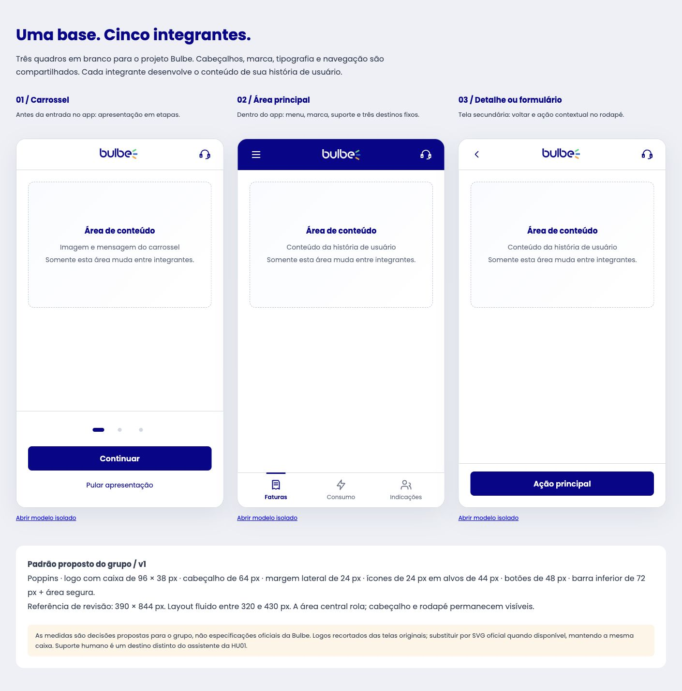

# Kit Bulbe compartilhado

Abra `docs/base-visual/index.html` com Live Server para comparar os três modelos. Esta pasta é uma referência compartilhada para prototipação; não substitui a implementação em `pages/` e `assets/`. Também há onboarding.html, app.html e detail.html isolados. A faixa de conteúdo tracejada é um guia e deve sair quando vocês inserirem sua tela.

## Para usar no Figma Make
1. Abra esta pasta no seu clone do repositório.
2. Anexe BulbeLayout.tsx, bulbe-base.css e Guidelines.md ao seu Make. O TSX já inclui os logos; não precisa anexar os PNGs. Pode anexar a imagem previa.png como apoio visual.
3. Cole o conteúdo de PROMPT-FIGMA-MAKE.txt.
4. Se o projeto já tiver telas, peça a migração delas para o componente, preservando seu conteúdo.
5. Confiram os três modelos em grupo antes de adotar v1. Todos usam os mesmos arquivos e mesmas medidas. Anexar arquivos é contexto para o Make, não garantia de cópia exata: revise o resultado.

As medidas são uma proposta para o grupo. Poppins e os logos foram identificados nas referências exportadas anteriormente do Figma Bulbe. Os recortes PNG não substituem o arquivo oficial da marca; usem o mesmo SVG oficial se conseguirem exportá-lo.

## Conteúdo
- index.html e três HTMLs: visualização local, sem instalação (fonte Poppins requer internet).
- bulbe-base.css: tokens e estilos compartilhados.
- BulbeLayout.tsx: componente reutilizável para Make/React, com callbacks de navegação.
- Guidelines.md: contrato visual e regras entre integrantes.
- PROMPT-FIGMA-MAKE.txt: instrução comum.
- assets: mesmos logos originais usados em todos os modelos.
- demo.js: interações demonstrativas, sem backend.

Não declare implementação concluída só por aplicar esta base. Cada história ainda exige seu conteúdo, fluxo, dados e validação. Se a disciplina exigir HTML/CSS/JS puro, o React do Make deve ser adaptado para essa entrega.

## Prévia

## Arquivos para anexar no Make

- [Componente BulbeLayout](BulbeLayout.tsx)
- [CSS compartilhado](bulbe-base.css)
- [Regras do grupo](Guidelines.md)
- [Prompt comum](PROMPT-FIGMA-MAKE.txt)

## Verificação

A galeria HTML foi conferida no navegador: fonte Poppins carregada, três cabeçalhos de 64 px, caixas de logo de 96 × 38 px e seleção demonstrativa da aba Consumo. O TSX ainda precisa ser integrado e validado no projeto Make; não é parte do JavaScript vanilla da entrega. Os destinos demonstrativos precisam ser conectados às telas de cada história.
