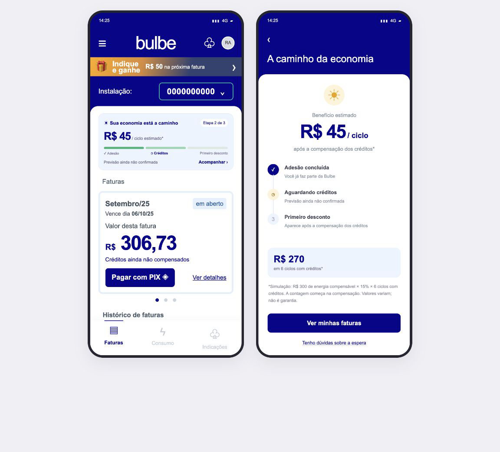

# Histórias de usuário

> Cada história nasce de uma oportunidade do mapa de jornada e vira uma Issue com o label `historia`.

| ID | História | Oportunidade de origem | Prioridade | Issue |
| --- | --- | --- | --- | --- |
| HU01 | Como Renata, cliente que recebeu sua primeira fatura e não compreende a cobrança, quero acessar explicações em linguagem simples por um assistente dentro do aplicativo para entender os valores e saber qual próximo passo realizar. | #3 (com apoio de #2) | Alta (proposta) | #5 |
| HU02 | Como Renata, cliente que ainda não percebeu a economia esperada, quero acompanhar o que falta para o benefício aparecer e quanto posso economizar, para organizar o pagamento da segunda fatura com clareza sobre o serviço. | Gap entre adesão e percepção do benefício; apoio de O1/O3 | A definir; proposta individual | A definir |
| HU03 | Como cliente pessoa física da Bulbe no primeiro ciclo de contratação, quero acompanhar visualmente o andamento da minha adesão e consultar o próximo passo, para saber em que situação estou e se preciso realizar alguma ação. | #1 — acompanhamento da adesão durante a espera | Média (proposta individual; priorização pendente) | A definir |
| HU04 | Como pessoa que abre o app pela primeira vez, quero conhecer a Bulbe pelo carrossel antes do login, para entender o serviço antes de entrar. | Primeiro acesso ao app | A definir | A definir |
| HU05 | Como cliente da Bulbe, quero calcular e conferir minha economia usando períodos e bases comparáveis, para entender de onde vem o resultado e avaliar o benefício com confiança. | #3 — transparência e compreensão da economia | A definir | A definir |

## HU01 — Esclarecer dúvidas com o assistente da Bulbe

**Status:** reformulação alinhada à orientação do professor relatada por Vinicius; priorização coletiva no MVP a confirmar.  
**Responsável:** Vinicius Gorini (@viniciusgorini)  
**Prioridade proposta:** Alta  
**Persona de referência:** [P2 — Renata Alves: compreender e conferir](personas/consolidadas.md#p2--renata-alves-compreender-e-conferir)  
**Momento da jornada:** recebimento e conferência da primeira fatura  
**Oportunidade principal:** [#3 — compreensão da cobrança](https://github.com/pedroschott/202602-projeto1-b-05/issues/3), com apoio de [#2 — acesso à informação e à fatura](https://github.com/pedroschott/202602-projeto1-b-05/issues/2)  
**Fluxo proposto:** convites contextuais no início e no detalhe da fatura → assistente/FAQ → informação ou tela correspondente.

### História

Como Renata, cliente que recebeu sua primeira fatura e não compreende a cobrança, quero acessar explicações em linguagem simples por um assistente dentro do aplicativo para entender os valores e saber qual próximo passo realizar.

### Critérios de aceite

- [ ] O assistente pode ser acessado pela tela inicial e pelo detalhe da fatura.
- [ ] Os convites identificam claramente que se trata de um assistente virtual.
- [ ] O cliente consegue iniciar a interação por perguntas prontas, sem precisar digitar.
- [ ] O acesso pela fatura oferece perguntas relacionadas à cobrança.
- [ ] As respostas usam linguagem simples e informações verificadas, sem inventar regras de faturamento ou valores.
- [ ] Quando aplicável, a resposta oferece um botão para a tela correspondente do aplicativo.
- [ ] Quando não há informação suficiente, o assistente informa a limitação e oferece um caminho de atendimento.
- [ ] Ao sair da conversa, o cliente consegue retornar à tela de origem.
- [ ] Carregar perguntas, respostas e dados fictícios de demonstração em JSON via `fetch`, com estados de carregamento, falha e tentativa novamente.
- [ ] Funcionar em largura de 360 px sem rolagem horizontal.

### Wireframes da mesma história

1. **Início do app:** convite visível e identificado para conversar com o assistente sobre dúvidas do serviço e da cobrança.
2. **Detalhe da fatura:** gancho contextual, como “Não entendeu esse valor? Pergunte ao assistente”, preservando o assunto ao abrir a conversa.
3. **Assistente/FAQ:** perguntas prontas, explicações curtas, botões para os destinos correspondentes e retorno à origem.

As três telas demonstram descoberta, entrada e uso do mesmo recurso e pertencem à HU01.

### Indicador e validação

Indicador pretendido: pagamento da primeira fatura. A hipótese é que explicações acessíveis no momento da dúvida apoiem a compreensão e a escolha do próximo passo. Nenhum impacto foi medido.

No protótipo, verificar se uma pessoa encontra o convite sem instrução, reconhece que é um assistente virtual, inicia uma pergunta, compreende a explicação, segue o encaminhamento e volta à tela de origem. Incluir uma pergunta sem resposta disponível para verificar o encaminhamento ao atendimento. Esse teste avalia descoberta, compreensão e navegação; não comprova redução de inadimplência.

### Limites e integração

A HU01 oferece explicações e encaminhamentos. Não substitui o acompanhamento da espera pelo benefício (HU02), o acompanhamento da adesão (HU03), os detalhes da cobrança (HU04) ou a calculadora (HU05); integra esses destinos quando disponíveis. Não confirma pagamentos reais.

Perguntas prontas constituem o fluxo mínimo. Conversa livre, voz e integração com modelo de IA não são requisitos fechados nesta revisão; sua inclusão e viabilidade dependem de definição posterior. O protótipo não deve apresentar respostas predefinidas como IA já implementada.

### Issues vinculadas

- Persona e jornada individual de origem: #4
- História: #5
- Três wireframes: #6
- Protótipo de alta fidelidade: #7
- Implementação: #8

Wireframe, protótipo e implementação permanecem como tarefas planejadas, sem conclusão atribuída nesta revisão.

## HU02 — Acompanhar a espera até o benefício aparecer

**Status:** substitui a HU02 anterior com a proposta originalmente registrada como HU06; revisão do squad e entrada no MVP pendentes.

**Responsável:** Pedro Marcondes Dombeck Schott (@pedroschott)

**Persona de referência:** [P2 — Renata Alves: compreender e conferir](personas/consolidadas.md#p2--renata-alves-compreender-e-conferir)

**Momento da jornada:** intervalo entre adesão e percepção do benefício, com foco no cliente que chega à segunda fatura sem compreender a economia esperada.

**Oportunidade de origem:** gap de percepção do benefício relatado por Pedro em 20/10/2026; relacionado a acompanhamento (O1) e compreensão da economia (O3), sem atribuir essa observação às evidências históricas do projeto.

### Histórico da substituição

Em 22/10/2026, a proposta de Pedro antes identificada como HU06 ([PR #26](https://github.com/pedroschott/202602-projeto1-b-05/pull/26)) passa a ocupar a HU02, substituindo “Localizar a primeira fatura sem o aviso”, vinculada à persona individual Célia Martins. A nova HU02 mantém a persona Renata e o foco na espera pelo benefício e na segunda fatura; não é uma mudança de nome da persona.

A [versão anterior da HU02](https://github.com/pedroschott/202602-projeto1-b-05/blob/02de82e116e6ceb229a12cc417eb9f7e41673adb/docs/historias.md#hu02--localizar-a-primeira-fatura-sem-o-aviso) permanece no histórico do Git. A [Issue #9](https://github.com/pedroschott/202602-projeto1-b-05/issues/9) ainda descreve essa versão anterior e não foi reescrita nem encerrada nesta alteração. A vinculação da nova HU02 a uma Issue fica pendente de alinhamento após a revisão deste PR.

O identificador HU06 deixa de representar uma história separada. As contribuições individuais de persona e as demais histórias foram preservadas; somente as referências à HU02 foram ajustadas. O HTML da antiga HU06, [removido anteriormente](https://github.com/pedroschott/202602-projeto1-b-05/commit/3fb8c0bebbd11e0ec10bf4cda9991bbe3612be42), não é restaurado; o PNG passa a usar o nome `hu02-espera-beneficio.png`.

### Problema e hipótese

Renata precisa entender o benefício para confiar no serviço. Quando a economia demora a ficar visível, pode não entender o que está acontecendo nem o valor da continuidade. A hipótese é que tornar a espera e o benefício esperado compreensíveis ajude a organizar o pagamento da segunda fatura. Não houve pesquisa que comprove essa causa de atraso nem medição de impacto.

O foco está **antes do primeiro desconto aparecer**, e não em comemorar uma economia já realizada. O cenário do wireframe é ilustrativo: a existência de cobrança antes da compensação, os componentes cobrados e a sequência operacional precisam ser confirmados com a Bulbe. Não se afirma que todo cliente receba duas faturas Bulbe sem benefício.

### História

Como Renata, cliente que ainda não percebeu a economia esperada, quero acompanhar o que falta para o benefício aparecer e quanto posso economizar, para organizar o pagamento da segunda fatura com clareza sobre o serviço.

### Proposta de solução

Card compacto e persistente na home, com progresso visual por marcos: **adesão → créditos → primeiro desconto**. O estado representado é “aguardando créditos”, sem data confirmada para o primeiro desconto. A segunda tela detalha os mesmos marcos e apresenta uma estimativa de economia futura.

A gamificação é básica: progresso e reconhecimento das etapas, sem pontos, prêmio financeiro adicional, missão obrigatória ou convite novo de indicação. O banner de indicação pertence à interface usada como referência; não integra a HU02. A barra representa etapas operacionais, não percentual de tempo decorrido ou garantia de proximidade da conclusão. As etapas são uma simplificação para revisão com a Bulbe.

### Critérios de aceite

- [ ] Manter o card acessível na home durante a espera pelo primeiro desconto, com acesso ao detalhe do acompanhamento.
- [ ] Identificar por texto e elementos visuais a etapa concluída, a etapa atual e o que falta; não depender apenas da cor das barras.
- [ ] Usar etapas e situação reais na implementação; se houver pendência do cliente, mostrar a ação necessária. Não avançar por tempo decorrido ou por pagamento.
- [ ] Mostrar previsão somente quando confirmada pela operação; na ausência dela, informar “Previsão ainda não confirmada”.
- [ ] Diferenciar economia estimada de desconto lançado. Antes da compensação, não apresentar a projeção como valor já economizado ou saldo disponível.
- [ ] Apresentar estimativa personalizada somente com dados e regra aplicável confirmados; sem dados suficientes, manter o acompanhamento sem inventar valor.
- [ ] Explicitar a base da simulação: R$ 300 de energia compensável × 15% = R$ 45 por ciclo; R$ 270 em seis ciclos com créditos. Os seis ciclos começam na compensação, não na adesão, e não são um prazo para o benefício acabar.
- [ ] Não aplicar o percentual sobre o total da conta nem prometer valor fixo: consumo, tarifas, créditos e contrato podem alterar o resultado.
- [ ] Manter a segunda fatura acessível, com valor, vencimento e situação vindos dos dados. Aguardar créditos não deve gerar orientação automática para deixar de pagar ou para pagar cobranças em duplicidade; dúvidas devem ter caminho de atendimento.
- [ ] Não considerar o clique no Pix como pagamento confirmado. A confirmação de pagamento não antecipa a compensação dos créditos nem muda artificialmente a etapa.
- [ ] Quando o desconto for efetivamente lançado, encerrar o estado de espera e mostrar o benefício realizado, distinguindo-o de projeções.
- [ ] Tratar carregamento, dados ausentes e falha de consulta sem simular progresso ou conclusão; oferecer tentativa novamente.
- [ ] Na implementação, carregar dados fictícios de demonstração via JSON/`fetch` e funcionar em 360 px sem rolagem horizontal, com altura limitada e rolagem interna.

### Wireframes da mesma história

1. **Home:** card persistente acima das faturas, barras verdes e etapa “aguardando créditos”.
2. **Acompanhamento:** marcos da espera, benefício estimado e acesso às faturas.

O PNG é um wireframe estático com dados fictícios, baseado na referência visual fornecida. Datas e histórico mantêm o contexto visual dessa referência; não representam uma conta real nem dados coletados para validar a segunda fatura. As duas telas ilustram o fluxo proposto; navegação, Pix, detalhes e atendimento não estão implementados neste artefato. Cor principal: `#08068D`.

### Indicador e validação

**Indicador principal pretendido:** inadimplência da segunda fatura — número de segundas faturas não quitadas integralmente até o vencimento dividido pelo total de segundas faturas com vencimento no período observado. Aguardar uma janela completa de conciliação para classificar os pagamentos pela data efetiva. Não reutilizar a taxa histórica da primeira fatura como taxa da segunda.

Em produção, comparar grupos equivalentes com e sem o card, separando clientes cujo desconto já começou daqueles que ainda aguardam. Definir com a Bulbe a identificação do segundo ciclo, janela de observação, tamanho da amostra e meta. Acompanhar também compreensão e procura por atendimento; nenhum efeito foi medido.

No teste de uso, verificar se a pessoa identifica a etapa atual, entende o que falta e distingue a estimativa de desconto já lançado. Pedir que encontre a segunda fatura e explique se o pagamento muda a etapa de créditos. Incluir ausência de previsão e falha de consulta. O teste avalia compreensão e navegação, sem comprovar redução de inadimplência.

### Limites e integração

A HU03 acompanha a adesão de forma geral; a HU02 faz a ponte entre a espera e a percepção do benefício, com foco no pagamento da segunda fatura. A HU05 confere a economia com dados comparáveis; a HU02 apenas apresenta uma projeção identificada e acompanha o início do desconto. O squad deve revisar essa integração antes de implementar.

Esta história reúne os critérios e o PNG de referência. Não implementa integração com faturamento ou créditos, nem altera o aplicativo real. Regras de cobrança antes da compensação, etapas e gatilhos devem ser confirmados com a Bulbe.

### Fontes do modelo de serviço

Fontes públicas consultadas em 20/10/2026, sem substituir o contrato individual:

- [Como funciona](https://bulbeenergia.com.br/como-funciona/): geração de energia, créditos, distribuição e desconto.
- [FAQ oficial](https://bulbeenergia.com.br/duvidas/): desconto sobre energia compensável, exclusões do cálculo e possibilidade de ciclo sem desconto quando não há créditos.
- [Termos de uso](https://bulbeenergia.com.br/termos-de-uso/): variação dos créditos e regras da fatura única conforme contratação.

## HU03 — Acompanhar o andamento da contratação

**Status:** proposta individual; aguarda alinhamento com as personas consolidadas e confirmação de entrada no MVP.  
**Responsável:** Pedro Padilha (contribuição individual — Persona 5)  
**Persona de referência:** [P1 — Cláudia Martins](personas/consolidadas.md#p1--cláudia-martins-acompanhar-e-acessar)  
**Momento da jornada:** cadastro e período de espera pela conexão  
**Oportunidade de origem:** acompanhamento claro da adesão durante a espera (O1 em `docs/jornada.md`)  
**Tela proposta:** Acompanhe sua adesão

### História

Como cliente pessoa física da Bulbe no primeiro ciclo de contratação, quero acompanhar visualmente o andamento da minha adesão e consultar o próximo passo, para saber em que situação estou e se preciso realizar alguma ação.

### Critérios de aceite

- [ ] Exibir uma linha de progresso com etapas identificadas e numeradas, destacando visualmente a etapa atual.
- [ ] Mostrar o status atual em linguagem simples; a compreensão não pode depender apenas de cores, números ou porcentagem.
- [ ] Exibir a última atualização quando essa informação estiver disponível nos dados.
- [ ] Mostrar pendências e o próximo passo quando houver informações confirmadas.
- [ ] Quando nenhuma ação for necessária do cliente, explicar que ele deve aguardar, sem inventar prazos ou datas de conexão.
- [ ] Definir as etapas do protótipo com base no processo confirmado pela Bulbe; enquanto isso não ocorrer, identificar os nomes e a sequência como ilustrativos.
- [ ] Carregar os dados fictícios de acompanhamento em arquivo JSON por meio de `fetch`.
- [ ] Exibir estados de carregamento e falha de consulta, com opção de tentar novamente.
- [ ] Não inventar status, datas, pendências, prazos ou previsões de conexão ausentes dos dados.
- [ ] Permitir navegar entre a tela de acompanhamento e as demais telas do protótipo.
- [ ] Funcionar em largura de 360 px sem rolagem horizontal, mantendo textos e etapas legíveis.

### Indicador e justificativa

**Indicador pretendido:** pagamento da primeira fatura. A inadimplência da primeira fatura foi de 32,4% entre setembro de 2025 e julho de 2026. A jornada também registra que alguns clientes passaram até 20 dias sem comunicação durante a espera. A hipótese é que informar o status e o próximo passo reduza a incerteza e ajude a preparar o cliente para as etapas seguintes. Isso não demonstra que a tela, por si só, reduzirá a inadimplência; nenhum impacto foi medido.

### Validação

Em um teste com o protótipo, pedir à pessoa para identificar em qual etapa está, explicar o que o status significa e dizer se precisa realizar alguma ação. Registrar se ela consegue responder sem ajuda. O teste avalia compreensão e navegação, não comprova redução de inadimplência, nem valida etapas oficiais do processo.

### Limites de escopo

Esta HU03 trata exclusivamente do acompanhamento da adesão durante o cadastro e a espera pela conexão. Não inclui explicar valores ou economia da primeira fatura (tema da HU01/HU04), nem detalhar a espera até o primeiro desconto e a projeção do benefício com foco na segunda fatura (tema da HU02). Os nomes e a sequência das etapas precisam ser confirmados com a Bulbe antes de serem apresentados como processo oficial.

## HU04 — Conhecer a Bulbe pelo carrossel antes do login

**Status:** primeira versão de implementação: três slides em JSON via `fetch`, botões de avançar/voltar, gesto no celular, indicador e opção de pular. Acesso pelo menu “Conheça a Bulbe” e por [pages/boas-vindas.html](../pages/boas-vindas.html). Nesta versão, Começar/Pular abrem a home de demonstração. Login e controle para apresentar somente no primeiro acesso ainda estão pendentes.
**Responsável:** Rodrigo Araujo Rigotto (@rodrigorigotto)  
**Persona de origem:** [Renata Alves](personas/vinicius-gorini.md)  
**Momento da jornada:** primeiro acesso ao app, antes do login  
**Oportunidade de origem:** [a definir — link para a issue]  
**Tela proposta:** Boas-vindas (carrossel)

### História

Como pessoa que abre o app da Bulbe pela primeira vez, quero ver em poucos slides o que a Bulbe oferece, como o serviço funciona e o que vou encontrar depois de entrar, para decidir com segurança se faço login ou crio conta, sem precisar me cadastrar primeiro para entender o app.

### Critérios de aceite

- [ ] Exibir o carrossel no primeiro acesso, antes da tela de login.
- [ ] Apresentar cada slide com título, texto curto em linguagem simples e imagem.
- [ ] Usar no conteúdo dos slides apenas informações confirmadas sobre o serviço; não prometer valor de economia nem prazo.
- [ ] Permitir avançar e voltar com gesto de deslizar e com botões.
- [ ] Mostrar um indicador de posição (por exemplo, "2 de 4" ou bolinhas).
- [ ] Oferecer "Pular" em todos os slides, levando direto à tela de login.
- [ ] No último slide, exibir o botão "Começar", que leva à tela de login.
- [ ] Não exibir o carrossel de novo para quem já viu ou pulou.
- [ ] Se uma imagem não carregar, manter o texto visível e a navegação funcionando.
- [ ] Carregar o conteúdo dos slides de um JSON fictício via fetch.
- [ ] Exibir carregamento, falha e opção de tentar novamente; em caso de falha, permitir seguir para o login.
- [ ] Funcionar em largura de 360 px sem rolagem horizontal.

### Indicador e validação

Indicador pretendido: avanço do primeiro acesso para o login ou cadastro. A hipótese é que entender a proposta da Bulbe antes do login diminua a desistência na entrada do app. Nenhum impacto foi medido.

Em um teste com protótipo, verificar se a pessoa consegue, sem ajuda, dizer o que a Bulbe oferece, navegar pelos slides, pular o carrossel e chegar à tela de login. O teste não comprova aumento de cadastros nem de conversão.

### Observação de consolidação

[a definir — verificar se esta história se sobrepõe a outra HU do squad, como login ou cadastro. Se não houver sobreposição, retirar esta seção.]
Esta história se sobrepõe à HU01 e à HU03 na explicação dos valores e da economia. O que ela acrescenta é a relação entre a cobrança da Bulbe e a conta da Cemig durante a espera. O squad deve decidir se a HU04 segue como história própria ou se esse critério entra na HU01.

## HU05 — Calcular e conferir a economia

**Status:** proposta individual; aguarda alinhamento do squad e confirmação de entrada no MVP.  
**Responsável:** Sophia Miranda (@sophiacmiranda)  
**Persona de referência:** [P2 — Renata Alves](personas/consolidadas.md#p2--renata-alves-compreender-e-conferir)  
**Momento da jornada:** conferência da primeira fatura e avaliação da economia  
**Oportunidade de origem:** [#3](https://github.com/pedroschott/202602-projeto1-b-05/issues/3) — transparência dos valores e da economia  
**Tela proposta:** Calculadora de economia

### História

Como cliente da Bulbe, quero calcular e conferir minha economia usando períodos e bases comparáveis, para entender de onde vem o resultado e avaliar o benefício com confiança.

### Critérios de aceite

- [ ] Permitir visualizar os períodos considerados no cálculo e identificar claramente as datas inicial e final de cada período.
- [ ] Identificar a base de comparação e os valores usados no cálculo, com rótulos e explicações em linguagem simples.
- [ ] Exibir a fórmula ou as etapas do cálculo para que o cliente consiga entender como o resultado foi obtido.
- [ ] Calcular e exibir a economia somente quando houver dados suficientes e bases e períodos considerados comparáveis segundo regras confirmadas pela Bulbe.
- [ ] Se os períodos não forem comparáveis, houver dados ausentes ou a regra de cálculo não estiver confirmada, explicar por que não é possível calcular a economia e não apresentar um valor como se fosse confiável.
- [ ] Diferenciar valores informados, estimativas e resultados calculados; não apresentar estimativa como economia garantida.
- [ ] Permitir revisar os dados de entrada e atualizar o resultado quando eles forem alterados.
- [ ] Carregar dados fictícios de demonstração em JSON via `fetch`, sem usar ou expor dados reais de clientes.
- [ ] Exibir estados de carregamento e falha, com opção de tentar novamente.
- [ ] Funcionar em largura de 360 px sem rolagem horizontal, mantendo valores, períodos e explicações legíveis.

### Indicador e validação

**Indicador pretendido:** compreensão da base de cálculo da economia e pagamento da primeira fatura. A hipótese é que tornar períodos, valores e fórmula verificáveis ajude a pessoa a compreender o benefício. Nenhum impacto foi medido; o wireframe não comprova economia real nem redução de inadimplência.

Em um teste de compreensão, pedir à pessoa para apontar quais períodos foram comparados, explicar a base do cálculo e descrever como o resultado foi obtido. Incluir pelo menos um cenário com períodos incomparáveis ou dados insuficientes e verificar se a pessoa entende por que nenhum valor de economia é apresentado.

### Limites de escopo e relação com outras histórias

Esta história foca na **interação para conferir o cálculo da economia**. A HU01 explica os componentes da primeira fatura, enquanto a HU04 aborda também a relação entre as cobranças da Bulbe e da Cemig. A HU05 pode complementar essas histórias, mas o squad deve decidir se a calculadora será uma tela própria ou parte da tela “Entenda sua fatura”.

As regras oficiais, os dados necessários e a fórmula devem ser confirmados com a Bulbe antes de implementar o cálculo. Não se deve presumir que períodos ou valores sejam comparáveis sem essa confirmação.
