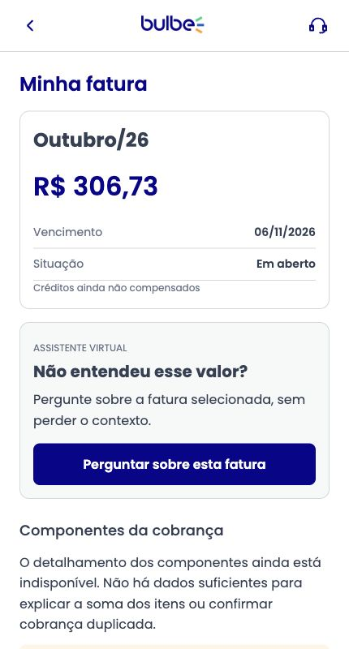
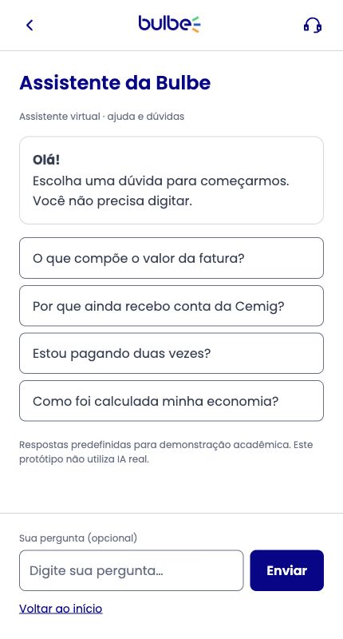

# HU01 — primeira implementação integrada

Responsável: Vinicius Gorini (@viniciusgorini). Relacionada às issues #5 e #8. Versão inicial para revisão; não comprova impacto em pagamento ou aprovação do conteúdo pela Bulbe.

## O que funciona

- Home do grupo → convite identificado → assistente de perguntas prontas.
- Ver detalhes em qualquer fatura da home/histórico → `pages/fatura.html` → convite contextual → assistente → retorno à mesma fatura.
- FAQ independente em `data/hu01-assistente.json`, carregada via `assets/js/api.js`; carregamento, falha com tentativa novamente e ausência de perguntas.
- Valor, vencimento e situação vêm dos mesmos cenários da HU02. O id e o cenário acompanham a navegação; valores ausentes não são inventados.
- Respostas com encaminhamentos para fatura, acompanhamento HU02 e suporte humano demonstrativo. A comparação de economia realizada e os componentes detalhados ainda estão indisponíveis.
- Campo opcional: só reconhece a pergunta cadastrada completa (ignorando acentos, caixa e pontuação básica); outros textos mostram a limitação e oferecem suporte. Não é IA. Textos do usuário são escapados.
- Template comum, fonte Poppins, logos do grupo e foco de teclado com azul/branco no lugar do laranja de baixo contraste.

## Executar

Abra `index.html` com Live Server. Não abrir por `file://`, pois a leitura JSON exige servidor.

## Roteiro de revisão

1. Home: abrir Conversar com o assistente; escolher perguntas, ler resposta e voltar ao início.
2. Home: Ver detalhes da fatura atual; abrir Perguntar sobre esta fatura; conferir referência e valor; voltar à mesma fatura.
3. Histórico: abrir Detalhes da primeira fatura (id 201 no cenário padrão); conferir que não aparece o valor da segunda.
4. Dúvida de economia: abrir Ver acompanhamento do benefício e conferir a tela real da HU02. Suporte abre o diálogo comum sem enviar mensagem.
5. Enviar pergunta não cadastrada; verificar limitação e caminho de suporte. Enviar somente espaços: validação solicita uma pergunta.
6. Para falha real do fetch em ambiente local: renomear temporariamente `data/hu01-assistente.json`, recarregar o assistente, confirmar a falha; restaurar o nome e clicar Tentar novamente. Nunca publicar o arquivo removido.
7. Para vazio: em cópia local, usar `{ "perguntas": [] }`; conferir aviso e suporte; restaurar o conteúdo original.
8. Fatura ausente: `pages/fatura.html?id=9999`. Dados incompletos: `pages/fatura.html?cenario=dados-incompletos&id=302`. Não mostrar dados de outra fatura para preencher lacunas.
9. Conferir 360 px de largura, rolagem interna, navegação por teclado e cabeçalho/rodapé sem sobreposição.

## Verificado em 03/11/2026

- Sintaxe dos scripts alterados e `git diff --check`.
- Home → assistente, perguntas prontas, suporte e retorno.
- Fatura atual (202) e histórica (201) → assistente com referência/valor corretos → retorno ao mesmo id/cenário.
- Encaminhamento de economia para HU02.
- Pergunta desconhecida e escape de texto com marcação HTML (nenhuma imagem injetada).
- JSON indisponível: erro real de consulta, restauração e tentativa novamente com sucesso. FAQ vazia e fatura inexistente.
- Assistente sem rolagem horizontal em 320 e 360 px. Outros fluxos móveis e carrossel devem fazer parte da revisão do squad.

## Limites

Não há backend, envio de mensagens, IA generativa ou pagamento. O suporte e as abas globais já existentes mantêm seus avisos de indisponibilidade. A FAQ é uma demonstração e precisa de revisão editorial e de regras com o grupo/Bulbe. Os critérios técnicos marcados em `historias.md` não equivalem à validação com usuários. O protótipo de alta fidelidade em Figma é um entregável separado.

## Evidências da primeira versão

Capturas da área do app com 430 px; teste de largura mínima realizado separadamente.

