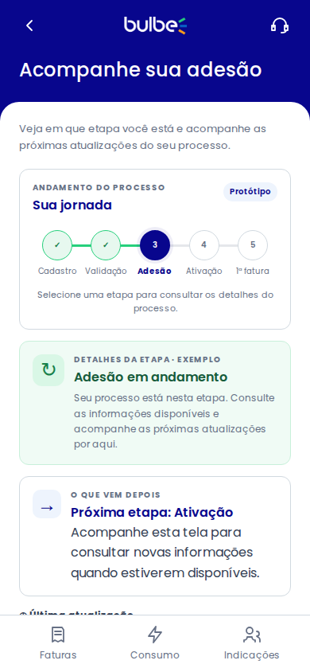
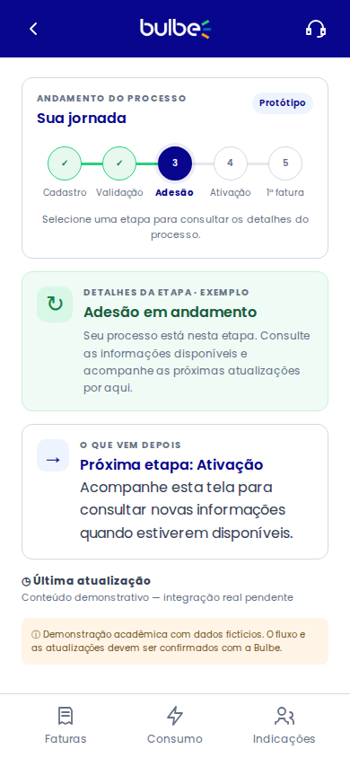

# HU03 — Acompanhar adesão | Implementação

Responsável: Pedro Padilha. Implementação acadêmica com dados fictícios, alinhada ao template compartilhado do Squad 05.

## Arquivos
- `pages/adesao.html`: estrutura com cabeçalho, logo e navegação comuns.
- `assets/css/hu03.css`: apenas estilos da jornada horizontal e cartões.
- `assets/js/hu03.js`: seleção e renderização das cinco etapas.
- `data/hu03-adesao.json`: cinco cenários fictícios.
- `assets/js/api.js`: leitura via fetch.
- `assets/js/layout.js`: acesso pelo menu da home.
- `scripts/test-hu03.mjs`: testes em Chromium (página HTTP, cenários, responsividade, suporte, teclado, erro e retry).

A implementação antiga foi retirada do diretório `docs/wireframes/Telas Prontas/` para evitar duplicação. Ela continua disponível no histórico de commits do GitHub; a versão mantida é `pages/adesao.html` e seus arquivos em `assets/` e `data/`.

## Capturas da tela integrada (390 × 844 px)
Capturas geradas a cada execução aprovada do GitHub Actions, incluindo as revisões solicitadas pelo squad.
As imagens foram produzidas pelo Chromium no GitHub Actions, com o projeto servido por HTTP.

## Como executar
Abra `index.html` pela extensão Live Server do VS Code e escolha **Acompanhar adesão** no menu. Não use `file://`: a leitura do JSON exige um servidor HTTP.

### Cenários
- `pages/adesao.html` — padrão, etapa 3 (adesão).
- `pages/adesao.html?cenario=cadastro` — etapa 1.
- `pages/adesao.html?cenario=validacao` — etapa 2.
- `pages/adesao.html?cenario=ativacao` — etapa 4.
- `pages/adesao.html?cenario=primeira-fatura` — etapa 5, com link para faturas.
- `pages/adesao.html?cenario=inexistente` — cenário ausente/estado vazio.

## Verificações
- [x] Carregamento HTTP e leitura do JSON com fetch no Chromium do GitHub Actions.
- [x] Cinco etapas, cinco cenários, link de faturas e estado vazio.
- [x] Tratamento de erro HTTP 503 e recuperação pelo botão "Tentar novamente".
- [x] Dimensões de 320, 360 e 390 px sem rolagem horizontal.
- [x] Suporte humano demonstrativo e seleção das etapas.
- [x] Etapa atual permanece fixa, mesmo ao consultar outras etapas; próximo passo e atualização sempre referem-se ao estado real fictício.
- [x] Textos de status coerentes nos cinco cenários; instruções diretas para o cliente.
- [x] Legendas de etapas com pelo menos 12 px em 320, 360 e 390 px.
- [x] Capturas em `docs/telas/` com cabeçalho e navegação visual do squad.
- [ ] Conferência final do fluxo pela equipe e aprovação visual do grupo.

**Automação:** [GitHub Actions — HU03](https://github.com/pedroschott/202602-projeto1-b-05/actions/workflows/hu03-screenshots.yml).

## Limitações
As etapas e atualizações são ilustrativas; a Bulbe ainda precisa confirmar o fluxo. A seleção de uma etapa apenas mostra informações gerais; ela não altera o status atual, o próximo passo nem o andamento real. Não há login, pagamento ou comunicação com cliente real. O teste automatizado usa um servidor HTTP estático equivalente ao Live Server, e não a extensão específica do VS Code.
